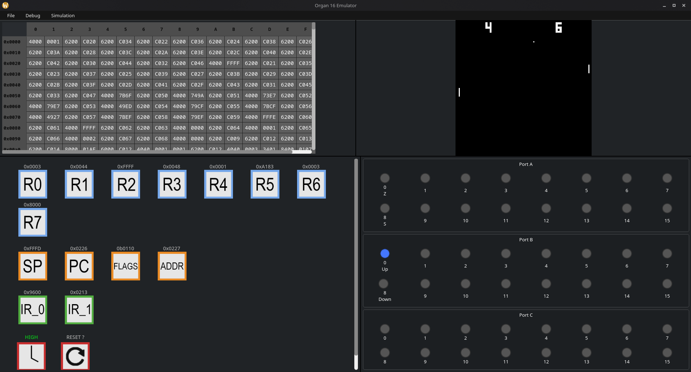

<div align="center">
  
  # Organ 16

  

  </br>
  
  


</br>
</br>

A simple 16-bit CPU architecture and its assembly-to-machine-code compiler + emulator

Designed with CMOS IRL implementation in mind (on breadboard for now)

</div>

</br>


<div align="center"><i>Emulator playing pong.bin program</i></div>
</br>
<div align="center"></br>
<i>Spinning cube (Rendered in emulator)</i></div>

## Repository Guide

- [asm-lang/](asm-lang/)  : contains extension(s) for common IDEs to support Organ16 assembly
- [circuits/](circuits/)  : contains every logisim (evolution) related files
- [docs/](docs/)          : documentation on the whole project (logisim, emulator, asm, irl implementation)
- [emulator/](emulator/)  : the source code for the emulator (written in C++ with Qt)
- [programs/](programs/)  : various test/demo programs to be executed on the emulator/on logisim
- [tools/](tools/)        : various tools used for developping and building the CPU and its extensions

## Architecture - Overview

16-bit CPU, designed with CMOS physical implementation in mind.

#### Data Width: 16 bits

- All internal data paths, ALU operations, and registers operate on 16-bit wide values.

#### Address Width: 16 bits

- Allows for a total of 1Mbit of addressable memory space, mapped linearly.

#### Instruction Width: 16 bits per word

- Supports both single-word and multi-word instructions, enabling operations with immediate values or extended addresses.

#### 8KB Stack

- Supports a very basic stack pointer and associated instructions such as POP, PUSH, etc...
- The stack's base size is 8KB (in future updates, there will be ways to augment/reduce it)
- Stack pointer's reset address is 0xffff (end of memory)

#### Registers:

- 8 General Purpose Registers (R0–R7), each 16 bits wide.
- 4 Special Purpose Registers:
  - Program Counter (PC) (16-bits) – holds the address of the current or next instruction. 
  - Instruction Register (IR_MAIN and IR_EXT) (16-bits) – stores the currently executing instruction/extension.
  - Stack Pointer (SP) (16-bits) – points to the top of the software-managed stack in RAM. 
  - Status Register (FLAGS) (4-bits) – holds condition flags: Zero (Z), Negative (N), Carry (C), and Overflow (O).

## ISA:

(Currently there are 59 instructions, but by design the CPU could support 128 instructions)
Each instruction is 16 bits wide but can be extended to 32 bits in some cases.

- The first 3 bits of the first word represent the Opcode.
- The next 4 bits represent the SubOpcode.
- The remaining 9 bits are used for operands, typically register identifiers.
  In certain instructions, a second 16-bit word may follow to hold a memory address or an immediate value.

### File format/Compiler :

The only file extensions recognized by the compiler are ".l" linker scripts and .org asm source files
The compiler is implemented in Python 3.10.
To compile a source file, first create a .l linker script and fill it with segments : 
(using json synthax)

```json
{
    "segments": [ 
        {"SourceFile.org": "0x0000"},
        {"SourceFile2.org": "0x3000"},
    ]
}
```

* Source files should be in the same directory as the linker script

Compiler will then create a .bin file (with the same name as the linker script)

It will place every source file at the memory address specified in the linker script.

(Memory Address shall be calculated so that the programs data doesn't overlap the stack (0xf000 to 0xffff))

(For example, if a program takes three words and is placed at 0xefff, its content will be cropped to let enough space for the stack) 

## More details can be found in the docs/ folder ! 


### Known issues/Missing features:

- Support for signed operations is not enforced; it is up to the program to choose whether to work with signed or unsigned numbers.

### Future plans : v3.0.0 :

- [ ] Interrupts
- [ ] Exceptions (a kind of interrupt)
- [ ] Cache
- [ ] Peripherals support

### Future-future plans (v4.0.0?)

- [ ] IRL breadboard implementation (???)
- [ ] PCB version (In a long long time 😄)