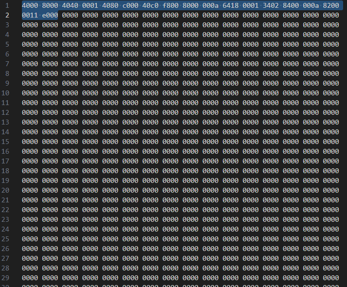

# Organ 16 assembly v1.5.0 - Documentation

## Syntax :

### Instructions :

Here are the 59 currently usable instructions :

| | Instruction  | `OpCode` | `SubOpCode` | Word count | Example          | Description of the example            |
|-|--------------|----------|-------------|------------|------------------|---------------------------------------|
|1| ADD          | `000`    | `1010`      | (1 word)   | ADD R1, R2, R3   | Add R2 and R3, store in R1            |
|2| SUB          | `000`    | `0001`      | (1 word)   | SUB R1, R2, R3   | Subtract R3 from R2, store in R1      |
|3| MUL          | `000`    | `0010`      | (1 word)   | MUL R1, R2, R3   | Multiply R2 and R3, store in R1       |
|4| DIV          | `000`    | `0011`      | (1 word)   | DIV R1, R2, R3   | Divide R2 by R3, store in R1          |
|5| MOD          | `000`    | `0100`      | (1 word)   | MOD R1, R2, R3   | Modulo R2 % R3, store in R1           |
|6| AND          | `000`    | `0101`      | (1 word)   | AND R1, R2, R3   | Bitwise AND, store in R1              |
|7| OR           | `000`    | `0110`      | (1 word)   | OR R1, R2, R3    | Bitwise OR, store in R1               |
|8| NAND         | `000`    | `0111`      | (1 word)   | NAND R1, R2, R3  | Bitwise NAND, store in R1             |
|9| NOR          | `000`    | `1000`      | (1 word)   | NOR R1, R2, R3   | Bitwise NOR, store in R1              |
|10| XOR         | `000`    | `1001`      | (1 word)   | XOR R1, R2, R3   | Bitwise XOR, store in R1              |
|11| NOT         | `001`    | `1011`      | (1 word)   | NOT R1, R2       | Bitwise NOT of R2 into R1             |
|12| MOVI        | `010`    | `0000`      | (2 words)  | MOVI R1, 0x1234  | Move 16-bit immediate into R1         |
|13| MOV         | `010`    | `0001`      | (1 word)   | MOV R1, R2       | Move R2's content into R1             |
|14| LOAD        | `011`    | `0000`      | (2 words)  | LOAD R1, 0x1000  | Load from memory to R1                |
|15| LOADR       | `011`    | `0011`      | (1 word)   | LOADR R3, R1     | Load from memory[R1] to R3            |
|16| STORE       | `011`    | `0001`      | (2 words)  | STORE R1, 0x1000 | Store R1 at memory[Immediate]         |
|17| STORER      | `011`    | `0010`      | (1 word)   | STORER R3, R1    | Store R3 at memory[R1]                |
|18| JMP         | `100`    | `0000`      | (2 words)  | JMP 0x1000       | Unconditional jump                    |
|19| JE          | `100`    | `0001`      | (2 words)  | JE 0x1000        | Jump if equal                         |
|20| JNE         | `100`    | `0010`      | (2 words)  | JNE 0x1000       | Jump if not equal                     |
|21| JB          | `100`    | `0011`      | (2 words)  | JB 0x1000        | Jump if below (unsigned)              |
|22| JBE         | `100`    | `0100`      | (2 words)  | JBE 0x1000       | Jump if below or equal (unsigned)     |
|23| JA          | `100`    | `0101`      | (2 words)  | JA 0x1000        | Jump if above (unsigned)              |
|24| JAE         | `100`    | `0110`      | (2 words)  | JAE 0x1000       | Jump if above or equal (unsigned)     |
|25| JL          | `100`    | `0111`      | (2 words)  | JL 0x1000        | Jump if less (signed)                                             |
|26| JLE         | `100`    | `1000`      | (2 words)  | JLE 0x1000       | Jump if less or equal (signed)                                    |
|27| JG          | `100`    | `1001`      | (2 words)  | JG 0x1000        | Jump if greater (signed)                                          |
|28| JGE         | `100`    | `1010`      | (2 words)  | JGE 0x1000       | Jump if greater or equal (signed)                                 |
|29| JSR         | `100`    | `1011`      | (2 words)  | JSR 0x1000       | Push PC, jump to subroutine                                       |
|30| RTS         | `100`    | `1100`      | (1 word)   | RTS              | Pop return address, jump to it                                    |
|31| HLT         | `111`    | `0000`      | (1 word)   | HLT              | Halt the CPU                                                      |
|32| CMP         | `001`    | `1010`      | (1 word)   | CMP R1, R2       | Compare R1 and R2 (Not commutative)                               |
|33| PUSH        | `101`    | `0000`      | (1 word)   | PUSH R1          | Push R1 onto the stack                                            |
|34| POP         | `101`    | `0001`      | (1 word)   | POP R1           | Pop top of stack into R1                                          |
|35| IN          | `111`    | `0001`      | (2 word)   | IN R0, 0x1000    | Place input data from port mapped at address 0x1000 into R0       |
|38| OUT         | `111`    | `0010`      | (2 word)   | OUT R0, 0x1000   | Outputs R0 to output port mapped at addresss 0x1000               |
|41| RAND        | `111`    | `0011`      | (1 word)   | RAND R0          | Reads a 16 bit random number into R0                              |
|42| SHL         | `000`    | `1011`      | (1 word)   | SHL R0, R1, R2   | Shifts R1 left by "R2 bits", places the result in R0 (logical)    |
|43| SHR         | `000`    | `1100`      | (1 word)   | SHR R1, R0, R2   | Shifts R0 right by "R2 bits", places the result in R1 (logical)   |
|44| XNOR        | `000`    | `1101`      | (1 word)   | XNOR R1, R2, R3  | Bitwise XNOR, store in R1                                         | 
|45| MIN         | `000`    | `1110`      | (1 word)   | MIN R0, R1, R2   | Stores the smallest (unsigned) of R1 and R2 into R0               |
|46| MAX         | `000`    | `1111`      | (1 word)   | MAX R0, R1, R2   | Stores the biggest (unsigned) of R1 and R2 into R0                |
|47| SIN         | `001`    | `0000`      | (1 word)   | SIN R0, R1       | Stores sin(R1) into R0 (R1 = angle in turns, signed Q1.15 result) |
|48| COS         | `001`    | `0001`      | (1 word)   | COS R0, R1       | Stores cos(R1) into R0 (R1 = angle in turns, signed Q1.15 result) |
|49| TAN         | `001`    | `0010`      | (1 word)   | TAN R0, R1       | Stores tan(R1) into R0 (R1 = angle in turns, signed Q8.8 result, saturated) |
|50| SQRT        | `001`    | `0011`      | (1 word)   | SQRT R0, R1      | Stores the integer square root of R1 (unsigned) into R0           |
|51| POW         | `001`    | `0100`      | (1 word)   | POW R0, R1, R2   | Stores R1 raised to the power R2 (low 16 bits) into R0            |
|52| ABS         | `001`    | `0101`      | (1 word)   | ABS R0, R1       | Stores the absolute value of R1 (signed) into R0                  |
|53| NOP         | `000`    | `0000`      | (1 word)   | NOP              | No operation, but not halt either, just do nothing for one tick   |
|54| INC         | `001`    | `0110`      | (1 word)   | INC R1           | R1 = R1 + 1 (wraps at 0xFFFF)                                     |
|55| DEC         | `001`    | `0111`      | (1 word)   | DEC R1           | R1 = R1 - 1 (wraps at 0x0000)                                     |
|56| LOADRP      | `011`    | `0100`      | (1 word)   | LOADRP R3, R1    | Load memory[R1] into R3, then R1 = R1 + 1                         |
|57| STORERP     | `011`    | `0101`      | (1 word)   | STORERP R3, R1   | Store R3 at memory[R1], then R1 = R1 + 1                          |
|58| COMPI       | `001`    | `1000`      | (2 words)  | COMPI R1, 0x10   | Compare R1's value with the 0x10                                  |
|59| COMPM       | `001`    | `1001`      | (2 words)  | COMPM R1, 0x1000 | Compare R1's value with memory[0x1000]                            |
|60| ADDI        | `010`    | ``          |
|61| SUBI        | `010`    | ``          |
|62| MULI        | `010`    | ``          |
|63| ANDI        | `010`    | ``          |
|64| ORI         | `010`    | ``          |
|65| XORI        | `010`    | ``          |
|66| SHLI        | `010`    | ``          |
|67| SHRI        | `010`    | ``          |
|68| MODI        | `010`    | ``          |
|69| DIVI        | `010`    | ``          |
|70| NANDI       | `010`    | ``          |
|71| NORI        | `010`    | ``          |
|72| NOTI        | `010`    | ``          |
|73| XNORI       | `010`    | ``          |
|74|
|75|
|76|
|77|
|78|
|79|
|80|

#### Notes : 

- DIV and MOD by 0 give 0. MIN and MAX are unsigned.
- SIN, COS, TAN take an angle in turns (0x4000 = 90°). SIN and COS return Q1.15, TAN returns Q8.8 (saturated).
- SQRT is floor(sqrt(R1)). POW is R1^R2 truncated to 16 bits (0^0 = 1). ABS is signed (0x8000 stays 0x8000).
- INC, DEC leave the flags untouched. LOADRP, STORERP increment the pointer after the access; don't use the same register twice.
- COMPI, COMPM only set the flags and are not commutative: the register is the left operand.
- RAND reads (virtual) IO port 3 (random generator).

### Instruction decomposition : 


### Immediates : 

Immediates are hard-coded literal values used directly in instructions for operations, jumps, or memory manipulation.
They are not loaded from memory but embedded directly into the instruction at compile time.

As of Organ 16 Assembly v1.5.0, immediates can be written in the following formats:

Binary: Prefix with 0b (e.g., 0b10101)

Decimal: Plain number with no prefix (e.g., 12)

Hexadecimal: Prefix with 0x (e.g., 0xABCD)

Immediates can also be operations to be evaluated at compile time : MOVI R0, 2 * 2

### Constants :

Constants are defined using the @define directive and serve as named values that can be reused throughout the source code.
Once defined, a constant will be replaced with its corresponding value during compilation, allowing for cleaner, more maintainable code.

Example :
```asm
@define SCREEN_WIDTH  128

LOAD R1, SCREEN_WIDTH
```

### Labels :

Labels act similarly to functions or named locations within a program. In .org source files, they are defined using a human-readable name. However, in the compiled .bin file, they are represented by their corresponding memory addresses.

A program can use JMP or conditional jump instructions to jump to any label at any point during execution. Labels are essential for implementing control flow structures such as loops, branches, and subroutines.

Example :
```asm
start:
    LOAD R1, 0x10
    JMP end

end:
    HLT
```

### Comments :

Comments can appear anywhere in a line—either on a line by themselves or at the end of a line of code.
A comment begins with either the # or ; symbol and continues to the end of the line. Comments are ignored during compilation and have no effect on the resulting binary.

Examples:
```asm
LOAD R1, 0x10     ; Load value into register R1

# This is a full-line comment
```

## Compiling :

### Source files

Source files (.org) follow the org16 format and contain the raw assembly instructions to be compiled.
Source files should be in the same directory as the linker script

### Linker file

The linker file (.l) (format = json) is responsible for combining multiple source files into a single executable program (.bin).
When the compiler opens the linker file, it searches for a segments list that specifies every source file to be combined along with their respective memory start addresses. This allows the compiler to properly map each module in memory.
If a file is overlapping the stack space (0xF000 - 0xFFFF) it will be truncated or even fully removed as this memory region must remain blank to preserve runtime stack operations.
As of Organ 16 Assembly v1.5.0, users can freely map data into the framebuffer region (0x8000 – 0xBFFF) during compilation.
Note: This data will not be automatically displayed on-screen; screen output only occurs during runtime via the STORE or STORER instructions.

### Python compiler

This is how you usually compile a file : (first argument is : compiler path, second arguemnt is : linker script path)

```powershell
python.exe Path/to/Compiler/compiler.py Path/to/Linker/Script/linker.l
```

This will output a .bin file that you can directly import into the emulator/logisim evolution's RAM component.

Example: 


